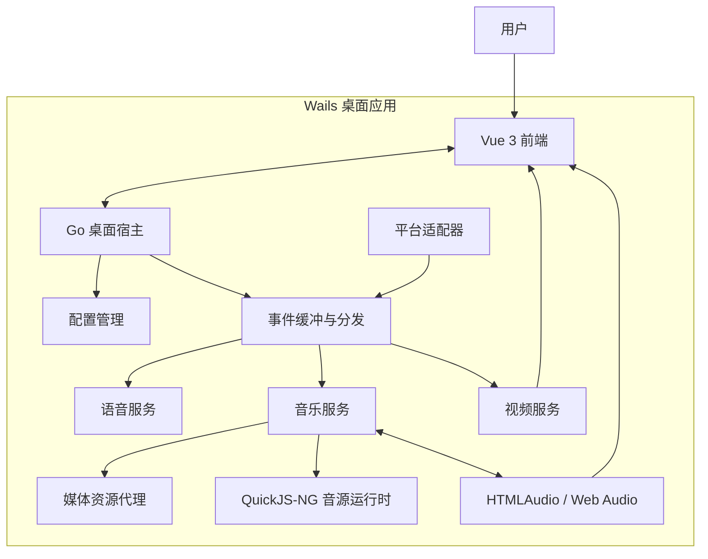
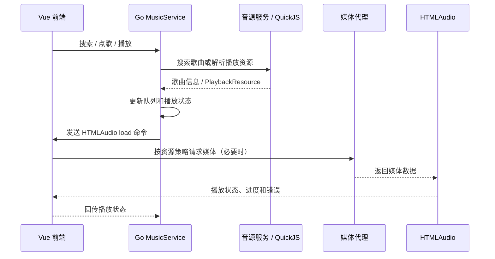

# My-LiveHub 总体架构

> 文档状态：按当前 dev 分支实现更新
> 更新日期：2026-11-28
> 适用范围：当前仓库中的 Windows 桌面应用、Go 服务、Vue 前端及音乐 / 洛雪音源运行时

## 1. 项目定位

My-LiveHub 是面向 Windows 本地桌面环境的直播互动与媒体辅助应用。应用由 Go 桌面宿主统一管理生命周期和业务服务，通过 Wails 将 Go 能力提供给 Vue 前端；前端负责管理界面、播放器界面和展示页面。

当前代码已经包含直播平台接入、事件处理、语音、音乐播放、洛雪音源脚本运行时、视频队列及相关管理界面。OBS 展示、扩展和其他业务能力应以对应模块的实际实现为准，不应把规划中的能力描述为已经全部落地。

## 2. 当前技术栈与运行边界

| 层次 | 当前实现 | 职责 |
|---|---|---|
| 桌面宿主 | Go、Wails v3 | 应用入口、窗口与 WebView 生命周期、服务注册、前后端桥接 |
| 前端 | Vue 3、TypeScript、Vue Router、Element Plus、Vite | 管理界面、业务页面、播放器 UI、歌词和展示组件 |
| 业务服务 | Go `app/internal` | 配置、事件、平台接入、语音、音乐、媒体资源和桌面业务 |
| 音源脚本运行时 | QuickJS-NG 原生运行时 | 在受控宿主 API 下执行导入的洛雪 JS 音源 |
| 媒体播放 | 浏览器 HTMLAudio / Web Audio | 实际音频播放、音量、播放状态和响度处理 |
| 本地持久化 | 配置 JSON 与本地文件 | 应用配置、音源脚本及相关本机状态 |

当前应用不是 Electron + Node.js 架构，也不通过启动独立 mpv 播放器进程实现音乐播放。桌面宿主、Go 服务和前端运行在同一桌面应用中；QuickJS 是嵌入式脚本运行时，不是外部音源播放器。

## 3. 总体结构

该图表示主要职责和数据关系，不表示每个模块都运行在独立进程中。除确有隔离需求的外部程序外，业务服务由 Go 宿主统一管理。

## 4. 应用启动与服务生命周期

1. Go 应用入口创建桌面宿主并注册需要暴露给前端的服务。
2. 宿主加载配置，按模块启用状态初始化对应服务。
3. 服务通过统一生命周期进行启动、停止和资源释放；未启用的模块不应启动不必要的后台任务或连接。
4. 前端通过 Wails 生成的绑定和运行时桥接调用 Go 服务，并接收服务事件。
5. 应用退出时取消上下文、停止后台任务、关闭媒体代理和运行时资源。

服务的具体启动顺序、错误恢复策略和窗口生命周期应以对应 Go 实现为准。模块停止后仍需保留的轻量事件监听，必须明确其用途和资源边界。

## 5. Go 服务与前端职责

### 5.1 Go 宿主和服务

Go 层负责：
- 应用与服务生命周期；
- 配置读取、合并、校验和保存；
- 直播平台连接及事件接收；
- 事件缓冲、分发及业务触发；
- 音乐搜索、队列、播放编排、播放历史和歌单业务；
- 洛雪脚本导入、能力识别、启停和运行时管理；
- 播放资源解析、刷新及受控媒体代理；
- 视频点播和其他桌面业务服务。

Go 服务不应把浏览器 DOM、HTMLAudio 元素或 Vue 组件状态当作可直接访问的本地对象。需要浏览器执行的操作通过 Wails 事件 / 命令桥接完成。

### 5.2 Vue 前端

前端负责：
- 管理端路由、页面和组件；
- 音乐搜索结果、播放队列、播放控制和歌单交互；
- HTMLAudio 元素及 Web Audio 节点的创建和控制；
- 歌词解析结果的展示、同步滚动和歌词覆盖层；
- 通过 Wails 绑定调用后端，并将浏览器播放状态反馈给 Go 服务。

前端不是第二套业务服务层。播放资源解析、音源脚本执行和队列状态的权威来源由 Go 服务维护；浏览器负责实际媒体播放和呈现。

## 6. 事件与平台接入

平台适配器负责各平台连接、协议解析、鉴权和断线恢复，并将接收到的事件交给统一事件处理路径。事件数据应尽可能保留平台来源、平台原生事件类型及必要原始字段，避免将不同平台的差异错误地归一化。

事件处理需要关注：
- 事件来源和用户身份的作用域；
- 事件时间与本机接收时间；
- 模拟事件与真实事件的区分；
- 有界缓冲、慢消费者和过载时的处理策略；
- 服务停止时订阅和后台任务的释放。

当前平台接入和事件能力以 `app/internal/platform`、`app/internal/events` 及相应桌面服务为准。尚未实现的平台或事件类型不应仅因架构规划而被标记为可用。

## 7. 音乐模块

### 7.1 组成

音乐模块由 Go 侧的业务编排和浏览器侧的播放执行共同组成：

- **MusicService**：管理模块状态、搜索请求、点歌队列、播放编排、播放历史、歌单及歌词任务。
- **音源服务**：聚合多个音源的搜索结果，并根据歌曲来源解析可用播放资源。
- **洛雪脚本运行时**：负责导入脚本、识别脚本能力、初始化脚本及调用声明的 Action。
- **HTMLAudio 播放引擎**：Go 侧实现统一播放引擎接口，并通过 Wails 桥接向前端发出播放命令。
- **前端 HTMLAudio**：实际创建和控制音频元素，向 Go 侧反馈播放、暂停、进度、错误和结束等状态。
- **媒体代理**：按需代理播放资源请求，处理上游请求头、Range 请求及响度处理所需的本地媒体通路。
- **歌词 UI**：显示同步歌词、当前行、歌词详情和独立歌词覆盖层。

### 7.2 播放流程

播放资源必须与待播放歌曲及来源匹配。播放 URL 解析成功不等于媒体一定可播放；播放失败、资源过期和刷新失败都需要回传明确状态。

### 7.3 HTMLAudio 播放边界

- 当前实际播放由前端 HTMLAudio 完成，不启动隐藏 mpv 进程。
- Go 侧统一维护播放引擎接口、播放会话、歌曲和资源信息。
- 前端按会话 ID 处理命令和状态，避免旧会话的异步回调污染新播放会话。
- 媒体代理用于需要请求头、Range 或响度归一化处理的资源；不需要代理的资源可按引擎策略直接加载。
- 响度归一化使用浏览器 Web Audio 能力及相应 worklet，不应把它描述为外部播放器 DSP。
- 音量、播放进度、暂停 / 恢复、切歌、结束和错误状态必须保持 Go 与浏览器两侧一致。

### 7.4 搜索、队列和歌单

多个音源可参与搜索，搜索结果保留来源信息。点歌请求和手动选歌进入统一队列，由 MusicService 管理播放顺序和播放状态。歌单播放由后端编排并处理切歌、暂停恢复和播放模式，不能绕开统一播放引擎。

音源、播放器和队列是不同职责：
- 音源负责搜索及解析播放资源；
- 播放引擎负责播放已经验证的资源；
- MusicService 负责队列、历史、歌单和播放生命周期。

## 8. 洛雪音源与 QuickJS-NG 运行时

### 8.1 运行时职责

洛雪 JS 音源通过嵌入式 QuickJS-NG 执行，不调用 Node.js、V8 或系统浏览器作为脚本运行环境。生产构建使用仓库维护的 QuickJS-NG 原生运行时，并由 Go 侧封装 Runtime 和宿主 API。

运行时负责：
- 创建和关闭 QuickJS Runtime；
- 注册脚本需要的受控宿主函数；
- 加载、初始化和调度音源脚本；
- 分发原生洛雪 Action 与 My-LiveHub 扩展 Action；
- 将脚本输出转换为 Go 业务可消费的数据；
- 控制执行时限、请求时限和资源生命周期。

### 8.2 脚本导入与能力

导入脚本时会校验源码、计算脚本标识并识别其声明的能力。脚本元数据、支持的平台、Action 能力及最近测试结果保存在本机脚本存储中。脚本启用后由 SourceManager 管理初始化、Action 注册和关闭。

当前生产搜索使用内置 QuickJS 搜索适配器覆盖 QQ、酷我、酷狗、网易云和咪咕等平台；导入脚本可以在其声明范围内提供或覆盖相应能力。内置歌词 Action 也由 QuickJS 运行时管理。脚本搜索和播放资源解析是不同能力，不能因脚本声明了播放 Action 就推断其搜索能力一定存在。

### 8.3 缓存

脚本混淆处理具有持久化缓存。缓存与脚本源码摘要及缓存版本关联；缓存命中仍须执行必要的校验步骤，不能将缓存视为跳过安全检查或完整性验证的理由。

缓存只用于减少重复初始化和混淆处理开销，不改变脚本对外行为、能力声明和 Action 调用语义。

### 8.4 网络安全边界

脚本发起的 HTTP 请求由宿主提供的受控网络能力执行。生产网络策略对目标 URL、DNS 解析结果和实际连接地址进行校验，阻止访问非公网地址及通过重定向绕过校验；生产路径不允许脚本借用任意自定义 RoundTripper 绕过目标地址策略。

网络请求、DNS、连接和播放资源验证应遵循统一超时与取消机制。测试环境为本地 HTTP 测试提供的放宽策略不得暴露为生产用户可配置的安全绕过选项。

### 8.5 运行时资源

Runtime、脚本队列、定时器、HTTP Transport、空闲连接和媒体任务必须在服务关闭时释放。任何性能缓存或脚本缓存都不能替代正确的 Runtime 生命周期管理。

## 9. 配置与本地数据

配置系统区分随程序发布的默认配置和本机覆盖配置。业务模块通过统一配置管理器读取和保存配置，不自行拼接路径或实现另一套配置合并规则。

当前约定：
- 开发模式显式使用 `dev` 参数，默认配置从工作区 `app/config/default/` 读取，本机覆盖配置从工作区 `app/config/local/` 读取。
- 正式模式不传入 `dev` 参数；默认配置从程序内嵌资源读取，本机覆盖配置放在程序所在目录的 `config/local/`。
- 正式版的日志、缓存和凭据分别使用程序目录下的 `logs/`、`cache/` 和 `secure/`。
- 洛雪音源脚本及其缓存通过配置管理器持久化为本机数据，不应将用户脚本、凭据或运行数据提交到 Git；仓库根目录 `lx-js/` 中的固定样本仅用于兼容性回归测试。

当前仓库的主要本地持久化方式是 JSON 配置和文件系统。

## 10. 其他业务模块

### 10.1 语音

语音服务由 Go 侧管理请求和生命周期，具体语音合成及播放按当前服务实现执行。慢速网络或合成任务不得阻塞平台事件接收。

### 10.2 视频

视频模块管理点播请求、队列和播放状态。其实际播放器接入和浏览器呈现应以当前视频服务代码为准；不得将音乐 HTMLAudio 引擎等同于视频播放引擎。

### 10.3 OBS、展示与扩展

OBS 连接管理、展示页面、扩展管理及其他模块应以当前实现为准。任何扩展或业务页面都不应绕过宿主的权限、生命周期和资源管理边界。尚未完成的能力列入后续计划，不作为已交付功能。

## 11. 安全、稳定性与资源管理

- 所有后台任务应绑定服务上下文，并在服务停止时取消。
- 队列必须有界，明确满载时的处理方式和可观测状态。
- 网络请求设置超时、取消和重定向策略。
- 用户导入的 JS 音源在受控 QuickJS Runtime 中执行，不直接获得任意 Go 内部对象或文件系统访问能力。
- 播放资源需校验来源和歌曲标识，资源刷新不能覆盖其他播放会话。
- 本地代理只监听回环接口，关闭时释放监听器和相关资源。
- 日志记录应服务于运行诊断，不保留已完成排查后临时添加的高频阶段计时日志。
- 关键服务必须处理重复启动、重复停止、取消与并发切换等生命周期场景。

## 12. 构建与验证

项目通过 Go、前端 TypeScript / Vite 和 Windows 构建链路完成验证。生产 QuickJS 测试需要匹配的 QuickJS-NG 原生运行时；不能只依赖不带生产构建标签的普通 Go 测试来证明生产脚本运行时可用。

持续集成当前覆盖：
- Hex / Python 生命周期脚本语法和检查；
- 前端类型检查及生产构建；
- Go 标准测试；
- QuickJS-NG 生产运行时构建及生产标签测试；
- 洛雪脚本搜索、播放资源和歌词相关集成验证；
- HTMLAudio 浏览器播放和歌词行为测试；
- Windows 应用资源嵌入和可执行文件构建。

任何架构或实现变更都应更新相应测试。测试未执行或 CI 未完成时，不得把功能标记为已通过验收。

## 13. 目录职责

当前代码以 `app/internal` 为 Go 业务实现主体，`app/frontend` 为 Vue 前端。目录应按实际代码职责演进，不要求提前创建尚无实现的空包。

主要目录：
- `app/internal/config`：配置管理和配置模型；
- `app/internal/core`：应用核心协调；
- `app/internal/events`：事件缓冲与事件相关结构；
- `app/internal/desktop`：Wails 桌面服务、前后端桥接和桌面业务；
- `app/internal/platform`：直播平台适配器；
- `app/internal/music`：音乐领域模型、队列、播放资源和音源服务；
- `app/internal/music/lxruntime`：QuickJS-NG Runtime、宿主 API、SourceManager 和洛雪 Action；
- `app/internal/voice`：语音业务；
- `app/frontend/src/views`：前端业务页面；
- `app/frontend/src/components`：可复用 UI 组件；
- `app/frontend/src/services`：前端服务和浏览器媒体能力；
- `app/config/default`：随程序发布的默认配置；
- `app/config/local`：开发环境本机覆盖配置。

新增目录应由实际功能驱动。不要为了符合一份预想目录树而创建空目录，也不要把所有业务拆成独立进程。

## 14. 维护与演进原则

当前版本的功能范围以代码、默认配置、发布包和自动化验收为准。后续维护按实际问题和明确需求开展：
1. 服务生命周期、并发切换和资源释放变更应配套回归测试；
2. 事件模型、队列背压和异常恢复策略发生变化时，同步更新可观测指标与文档；
3. OBS、展示和扩展能力以现有实现为准，新增能力需明确权限、生命周期和资源边界；
4. 洛雪脚本兼容性、QuickJS 安全边界及原生运行时升级应通过对应测试验证；
5. 安装、升级、配置和用户数据行为发生变化时，更新发布说明及备份指引；
6. 性能优化应基于可重复的测量结果，不保留无明确用途的临时诊断代码。

---

**维护规则：** 本文描述当前已实现的结构时以代码和 CI 为依据；规划中的功能必须明确标注为规划。实现、构建方式或模块边界发生变化时，同步更新本文及对应专项文档。
